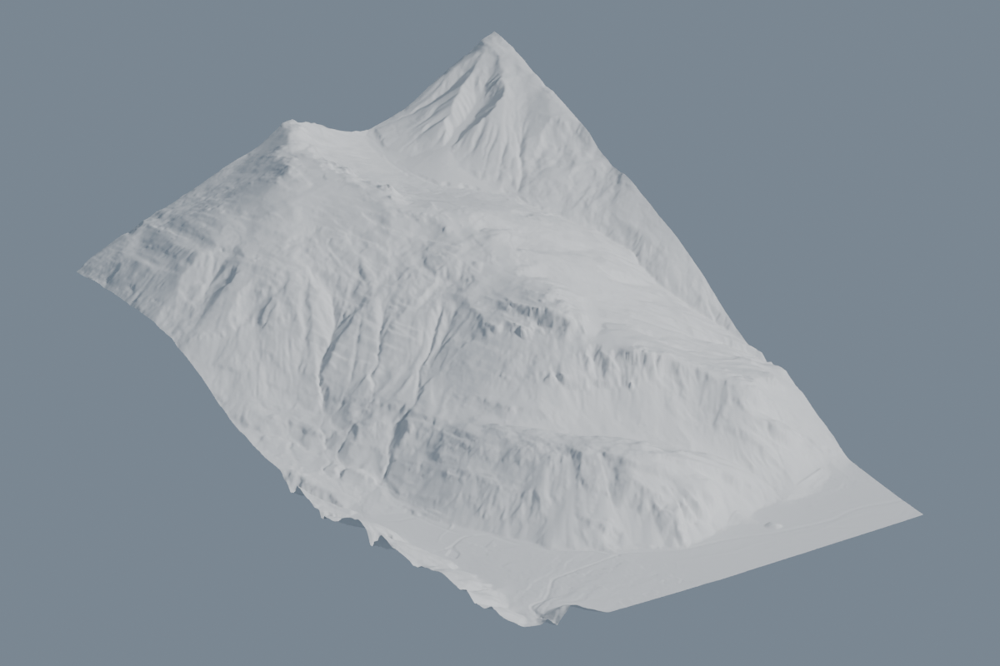

# Piste · Zillertal prototype

The first playable view follows the Penkenbahn out of Mayrhofen. A skier can orbit the mountain, see a cabin approach the upper station, tap the building and follow a piste downhill. Build this small scene on a real iPhone before extending coverage across the valley.

| Stage | Work | How we’ll judge it |
| --- | --- | --- |
| 1. Get the ground right | Crop Land Tirol’s 5 m bare-earth elevation grid around Penken and Mayrhofen. Preserve the source coordinates, build a metre-scale Blender mesh and check the two ends of the lift. | The valley, ridge and station approaches line up geographically, the mesh faces upward, and the relief reads from an oblique view at true vertical scale. |
| 2. Find the winter look | Use aligned forest and clearing masks, a snow and rock palette, and directional light in Blender. Overlay one geographically accurate piste as a separate feature. | The skier can follow the run through open snow and forest from two different camera angles. |
| 3. Get the mountain onto iPhone | Bring the terrain and a baked surface texture into a RealityKit view in the SwiftUI app. Bundle this first area locally. Add orbit, pan and zoom. | The camera moves smoothly between valley overview and station approach on the target phone. Compare the phone view with the Blender reference. |
| 4. Build one recognizable station | Model the upper station and a cabin in Blender from reference photos. Export them as separate assets. Use a verified station footprint and cable entrance for placement. | The roofline reads at map scale and the entrance, glazing and cabin read in close-up. |
| 5. Give the lift motion | Define the uphill and downhill cable paths using station entrances and support positions. Reuse the cabin model, keep cabins upright and slow them at the station. | A cabin arrives as another departs. The illustrative motion follows the cables as the camera moves. |
| 6. Make it useful to a skier | Give the station a tap target and show the pistes accessible from its exit. Keep piste geometry and IDs independent of the terrain texture. | Tap the roof, select a piste and trace it downhill on the phone. |
| 7. Extend coverage | Reuse the geographic transform, materials and lift logic for the next area. Add terrain tiles and levels of detail as the coverage grows. | Adjacent areas meet without seams and the map stays responsive on device. |

## Working files

Keep the terrain source and Blender work under `Terrain/` beside the Xcode project. Bring mobile-ready assets into the app at stage 3. The GeoTIFF supplies the ground elevations for later landmarks and overlays. [Land Tirol terrain data](https://www.tirol.gv.at/sicherheit/geoinformation/geodaten-tiris/laserscandaten/)

## Stage 1 · Penken terrain

Open [Penken.blend](Terrain/Penken.blend) in Blender 4.5 or newer. The opening view looks northwest from the valley side. In the Outliner, expand **Penkenbahn · location guides**, select **Penkenbahn · upper station**, then choose **View → Frame Selected** in the 3D viewport. Zoom back a little and orbit to see how the ground falls away on the approach. The two labelled crosses mark ground samples at the lift endpoints. Switch off the guides collection to see the relief on its own.

### What is in the scene

| Property | Value |
| --- | --- |
| Ground source | [Penken-5m.tif](Terrain/Penken-5m.tif), 1,201 × 801 bare-earth samples, 5 m spacing, projected CRS EPSG:31254 (MGI / Austria GK West) |
| Mesh extent | 6,000 m east–west × 4,000 m north–south between outer sample centres. Covers the Penken ridge, both stations and part of the valley floor. |
| Blender geometry | Every second sample in each direction, giving 10 m spacing and 601 × 401 vertices. The source keeps the full 5 m grid for closer work. |
| Scale and orientation | One Blender unit equals one metre. X points grid east, Y grid north, Z up. Horizontal and vertical scales match. |
| Local origin | Easting 113,500 m, northing 227,000 m, source elevation 600 m. Subtract these three values from projected coordinates and elevation to place objects in the scene. |
| Ground elevations | 597.7–2,241.7 m across the 5 m source crop. |

### Geographic checks

| Penkenbahn guide | Latitude, longitude (WGS 84) | Sampled ground | Published station elevation |
| --- | --- | ---: | ---: |
| Valley | 47.1634171, 11.8606363 | 645.6 m | 655 m |
| Upper | 47.1754503, 11.8293403 | 1,789.3 m | About 1,790 m |

The guide positions come from the mapped lift endpoints. The valley ground sample is about 9 m below the published station elevation. Use the guides to check the corridor at mountain scale. For a realistic station model, align the footprint, entrance and platform separately against imagery and building references. [OpenStreetMap lift geometry, © OpenStreetMap contributors](https://www.openstreetmap.org/way/30978865) · [Tirol’s published lift elevations](https://www.tyrol.com/activities/sport/hiking/mountain-lifts/penkenbahn-1)

### Rebuilding the terrain

From the Piste directory, run `uv run Terrain/build_scene.py`. This regenerates the Blender scene and PNG from the included GeoTIFF. Save any hand edits to a separate Blender file before rebuilding. For GIS inspection, open the TIFF directly in QGIS.

The [original GeoTIFF request](https://gis.tirol.gv.at/arcgis/services/Service_Public/terrain/MapServer/WCSServer?SERVICE=WCS&VERSION=1.0.0&REQUEST=GetCoverage&COVERAGE=Gelaendemodell_5m_M28&CRS=EPSG:31254&BBOX=110497.5,224997.5,116502.5,229002.5&WIDTH=1201&HEIGHT=801&FORMAT=GeoTIFF) selects the native 5 m grid. The included copy uses lossless compression and a standardized EPSG:31254 tag. Raster bounds follow **pixel edges**. Mesh vertices use **pixel centres**.

Elevation attribution for the crop, mesh and preview: **Datenquelle: Land Tirol – data.tirol.gv.at**, CC BY 4.0. The mesh samples the clipped grid at 10 m and the preview adds lighting. [Dataset and licensing metadata](https://www.data.gv.at/api/hub/repo/datasets/0454f5f3-1d8c-464e-847d-541901eb021a.ttl) · [CC BY 4.0](https://creativecommons.org/licenses/by/4.0/)

## First lift test · Blender

Open [Penkenbahn.blend](Lift/Penkenbahn.blend) in Blender 4.5 or newer. The camera starts outside the upper station as a cabin approaches. Press **Space** over the viewport to play. To inspect the valley station or the first tower, select its **Inspect** camera in the Outliner, then choose **View → Cameras → Set Active Object as Camera**. The [eight-second clip](Lift/Penkenbahn-test.mp4) shows the opening approach. The [three-view preview](Lift/Penkenbahn-preview.jpg) also shows the valley and tower.

The test scene links three editable libraries for the [upper station](Lift/Assets/Upper.blend), [valley station](Lift/Assets/Valley.blend) and [cabin](Lift/Assets/Cabin.blend). Keep the `Assets` folder beside the scene. A shared cabin model runs 30 times around a closed circuit. Each direction has two track ropes and a haul rope. The cabins remain upright, slow near the portals and turn inside the boarding halls.

The route follows the two station endpoints and three mapped pylons. The stations use rounded footprint outlines. Their façades, hall dimensions and platform heights are visual approximations. The tower heights, cable sag, number of animated cabins and station turnaround timing are prototype values. [Lift alignment and pylons](https://www.openstreetmap.org/way/30978865) · [Valley footprint](https://www.openstreetmap.org/way/236173117) · [Upper footprint](https://www.openstreetmap.org/way/141123075) · [© OpenStreetMap contributors](https://www.openstreetmap.org/copyright)

The valley building uses a white cantilevered shell, glazed street level and ticket canopy. The upper station has a timber terrace, a glazed boarding hall and photovoltaic panels. The cabin colors and 3S rope layout follow project references. [Station architecture and photos](https://www.nextroom.at/pdf.php?id=37742&inc=pdf&sid=13497) · [Lift planner’s photos and data, p. 24](https://www.seilbahnplanung.at/Projekte_2001-2017.pdf#page=24) · [Doppelmayr’s Penkenbahn reference](https://www.doppelmayr.com/referenzprojekte/referenzprojekt-30-tgd-penkenbahn/)

For a fresh build from the included terrain, run `uv run Lift/build_lift.py` from the Piste directory. It regenerates the three asset libraries, animated test scene and still preview. Save manual model edits separately before running it.
